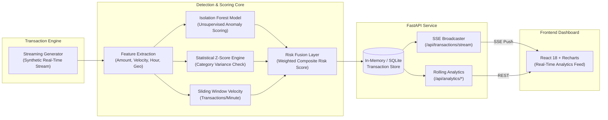

# ⚡ FinFlow — Real-Time Financial Transaction Anomaly Detection Pipeline


---

## 🌟 Overview

**FinFlow** is an enterprise-grade financial transaction monitoring and anomaly detection engine designed for banking and FinTech platforms. It processes continuous transaction streams, extracts multi-dimensional behavioral features, and applies an unsupervised **Isolation Forest** combined with **statistical Z-score limits** and **velocity heuristics** to flag suspicious activities in sub-second latency.

Full real-time observability is delivered via Server-Sent Events (SSE) into a React/TypeScript analytics dashboard featuring live throughput charts, risk distribution histograms, and category volume breakdowns.

---

## 🏗️ Architecture



---

## 🧠 Anomaly Detection Methodology

Every transaction is evaluated through a multi-tiered anomaly assessment:

1. **Unsupervised Machine Learning (Isolation Forest)**:
   - High-dimensional space partitioning based on:
     - `amount` (normalized transaction value)
     - `hour_of_day` & `day_of_week` (temporal behavior)
     - `transactions_in_last_hour` (customer activity burst)
     - `amount_zscore_vs_category` (deviation from merchant category norms)
2. **Statistical Z-Score Filter**:
   - Compares the transaction against historical means and standard deviations within the specific merchant category (e.g., groceries vs. jewelry).
   - Flags deviations exceeding $3\sigma$.
3. **Sliding-Window Velocity Analysis**:
   - Detects rapid-fire transactions from the same customer ID (e.g., card-testing fraud: $>4$ transactions in 60 seconds).
4. **Composite Risk Scoring**:
   - Normalizes scores into a continuous $[0.0, 1.0]$ risk metric.
   - Transactions with `risk_score > 0.65` trigger automated containment, alerting, and flagged state persistence.

---

## 🛠️ Technology Stack

| Layer | Technology | Responsibility |
|---|---|---|
| **Frontend** | React 18, TypeScript, Tailwind CSS, Recharts | Real-time SSE streaming feed, risk distribution charts, audit table |
| **API Layer** | FastAPI, Uvicorn, SlowAPI | Async endpoints, rate limiting, SSE streaming, OpenAPI docs |
| **ML & Analytics** | Scikit-Learn, NumPy, Pandas | Isolation Forest model training, Z-score computation, rolling stats |
| **Database** | SQLite, SQLAlchemy, aiosqlite | Asynchronous transaction logging and seed persistence |
| **Testing** | Pytest, pytest-asyncio | Unit testing for model convergence, score boundaries, and edge cases |
| **Deployment** | Docker, Nginx, Render, Vercel | Containerized production deployment with CORS & reverse proxy |

---

## 🧪 Test Suite

FinFlow includes automated tests validating detector precision, score boundaries, and anomaly injection accuracy:

```bash
cd backend
pytest -v
```

Tests verify:
- ✅ Normal transactions score below the $0.65$ threshold.
- ✅ Extreme outlier amounts ($>10\times$ category mean) reliably trigger anomaly flags.
- ✅ Velocity bursts ($>4$ transactions within 60s) trigger high-risk classification.
- ✅ Deterministic reproducibility across model training runs.

---

## 🚀 Local Quickstart

### Using Docker Compose
```bash
docker-compose up --build
```
- Open **http://localhost:3000** for the live dashboard.
- Open **http://localhost:8000/docs** for the FastAPI interactive OpenAPI documentation.

### Running Backend Manually
```bash
cd backend
python -m venv venv
# Windows:
.\venv\Scripts\activate
# Mac/Linux:
source venv/bin/activate

pip install -r requirements.txt
uvicorn app.main:app --reload --port 8000
```

### Running Frontend Manually
```bash
cd frontend
npm install
npm run dev
```

---

## 🔌 Core API Endpoints

| Method | Endpoint | Description |
|---|---|---|
| `GET` | `/api/health` | Service health status and active transaction volume |
| `GET` | `/api/transactions` | Paginated transaction list with optional `flagged_only=true` filter |
| `GET` | `/api/transactions/{id}` | Single transaction metadata and risk scoring breakdown |
| `POST` | `/api/transactions/generate` | Batch transaction generator running real-time anomaly detection |
| `GET` | `/api/transactions/stream` | Server-Sent Events (SSE) streaming real-time scored transactions |
| `GET` | `/api/analytics/stats` | High-level metrics: total volume, flagged count, flag rate % |
| `GET` | `/api/analytics/rolling` | Rolling window throughput (last 60s, 5m, 1h) |
| `GET` | `/api/analytics/categories` | Per-category volume, average amount, and anomaly rate |
| `GET` | `/api/analytics/risk-distribution` | Risk score histogram across 5 risk tiers |
